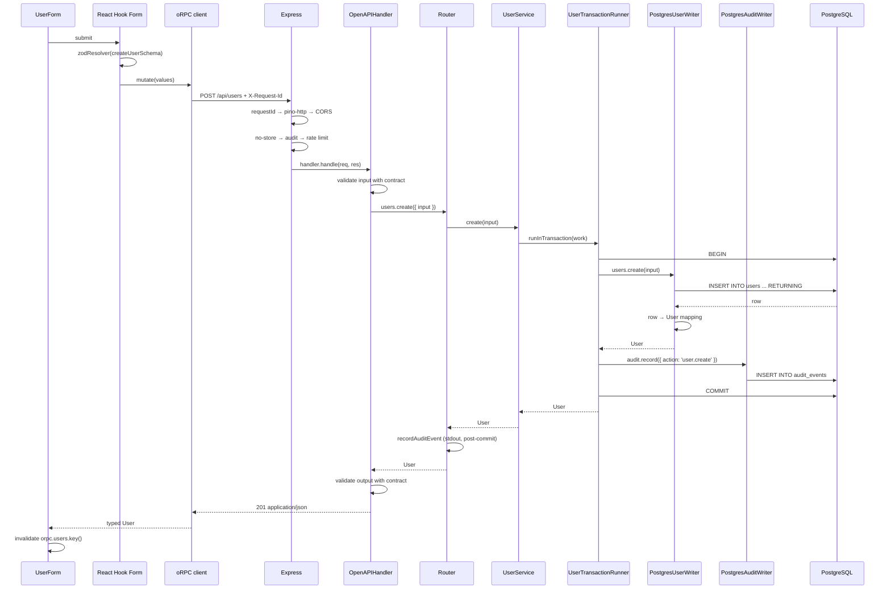

# Architecture and boundaries

## Dependency direction

```text
packages/contracts
  ├─ Zod API schemas
  ├─ oRPC contract
  └─ ApiClient type
        ▲                         ▲
        │                         │
   apps/api                  apps/web
   ├─ router (transport)     └─ OpenAPILink
   ├─ UserService                  │
   │  ├─ UserReader                └─ TanStack Query / React Hook Form
   │  └─ UserTransactionRunner
   │       ├─ PostgresUserWriter
   │       └─ PostgresAuditWriter
   └─ db/transaction.ts (Kysely adapter)
        │
        ▼
   PostgreSQL 19 (users, audit_events)
```

Rules:

- `contracts` depends only on `zod` and `@orpc/contract`. It knows nothing about Express, Kysely, or
  React.
- `api` depends on `contracts` and implements the transport, application services, repository
  ports, transaction boundary, and persistence.
- `web` depends on `contracts` and creates a client from it.
- Server implementation details never enter the web bundle.

The contract package is built with `tsc` to `dist` and consumed through the workspace symlink. During
development, the root `pnpm dev` command watches it, so contract edits propagate to the API and web.

## Two sources of truth, deliberately

There are two different kinds of truth:

1. **API truth** — what HTTP accepts and returns. Zod and oRPC own this.
2. **Persistence truth** — durable columns, constraints, indexes, and foreign keys. PostgreSQL
   migrations own this.

Kysely types are generated from the migrated database into `schema.generated.ts`. The repository
mapper converts a generated row into a Zod-owned API type. TypeScript checks both sides, so drift is
a compile error. Contract types are the shared application DTOs in this monolith; the service
imports them as types only, never the oRPC, Express, or Kysely runtime.

The mapper is not duplicate validation. It is the boundary between persistence and the public API.
See [database.md](database.md) for the full rationale.

## Request lifecycle



## Transaction boundary

The unit of work is one application service call, not one repository method. `UserService.create` opens exactly one PostgreSQL transaction and writes both the user and the durable audit row inside it. Resolving commits; throwing rolls back.

```text
UserService.create
  └─ UserTransactionRunner
       └─ db.transaction().execute(trx => {
            users: new PostgresUserWriter(trx),
            audit: new PostgresAuditWriter(trx, correlation)
          })
```

Rules:

- **One database, one transaction.** `createTransactionRunner` only wraps `db.transaction().execute`. True ACID across separate databases is not attempted; a future service split uses a transactional outbox plus async consumers.
- **Write adapters require `Transaction<DB>`.** `PostgresUserWriter` and `PostgresAuditWriter` cannot be constructed with the root `Kysely<DB>`; that would silently run outside the transaction. Read adapters (`PostgresUserReader`) use the root connection because list queries are not part of a write unit of work.
- **Repositories never open transactions.** Only the runner does. Repositories are composable inside a transaction and have no hidden commits.
- **The transaction context is module-local.** `UserTransaction` exposes only `users` and `audit`. There is no global repository registry or service locator.
- **No nested transactions or implicit joins.** Kysely 0.29 deprecates `Transaction.transaction()`. Compose the repositories you need in one callback; do not call another transactional service from inside a transaction.
- **No ALS request transaction.** `AsyncLocalStorage` remains for request IDs, logging, and actor propagation. A transaction scope is a correctness boundary and must be visible in the call graph.
- **No external I/O inside the transaction.** Network calls, email, and queue publishes belong after commit or in an outbox. This keeps rollback and any future retry safe.
- **Isolation is `READ COMMITTED` by default.** Use `SELECT ... FOR UPDATE` for contended read-modify-write. Add `SERIALIZABLE` with a bounded retry loop only for a specific invariant.
- **Retry is deferred.** When added, retry only `40001` and `40P01`, recreate the transaction and context per attempt, keep the callback side-effect-free, and never retry `23505` or domain errors. Use an idempotency key when commit ambiguity matters.
- **Keep transactions short.** Each transaction holds one pool connection. `db/client.ts` sets a connection timeout, an API statement timeout, and `idle_in_transaction_session_timeout`; migrations intentionally keep no statement timeout.

### Audit semantics

There are two audit streams:

- **Durable audit** — `audit_events` is written inside the transaction and records committed facts only. A rollback removes the user and the audit row together. Audit insert failure rolls back the user creation; that is the deliberate compliance trade-off.
- **HTTP audit** — the existing stdout middleware records every mutating request, including rejected and aborted attempts. The router emits the explicit `user.create` success event only after the service transaction has resolved. That call is non-throwing and never changes the HTTP result.

`23505` aborts the PostgreSQL transaction. The write adapter maps only the `users_email_key` constraint to `EmailAlreadyExistsError`; other unique violations stay raw, and the router maps the domain error to HTTP 409. Do not catch a unique violation and continue in the same transaction without an explicit savepoint.

## Observability and request safety

The HTTP pipeline is intentionally separate from the oRPC contract:

1. `requestId` validates or creates `X-Request-Id` and reuses a valid W3C `traceparent` trace ID.
2. `pino-http` emits one structured access log per request; `/healthz` and CORS preflights are
   excluded to keep infrastructure noise out of the stream.
3. `AsyncLocalStorage` carries the request logger, IDs, IP, and user agent to oRPC handlers. This
   avoids threading a context through `implement(contract)` just to log or audit.
4. Helmet and CORS apply response headers. CORS exposes the correlation and rate-limit headers to
   browser clients.
5. `/api` applies `Cache-Control: no-store`, mutation audit, and per-IP global/write rate limits.
   Audit runs before the limiters so rejected writes are still recorded.
6. oRPC remains before `express.json()` because it consumes the raw request body.

Access logs and audit logs are separate streams; audit records carry `audit: true`. Neither stream
contains request bodies, query strings, cookies, or authorization headers. Domain code emits
`recordAuditEvent(...)`; future authentication middleware can call `setRequestActor(...)` so later
events inherit the actor. Audit records are emitted at `info` regardless of `LOG_LEVEL`, so reducing
access-log volume cannot silently disable the audit stream.

Rate limiting is in-memory and per-process. `TRUST_PROXY` must match the deployment topology; `true`
is unsafe when clients can reach the API directly because `X-Forwarded-For` becomes spoofable. See
the README for configuration and shared-store guidance.

## Error policy

- **400** — input validation failed. Client error; logged at `info`, without a stack trace.
- **409** — duplicate email. `PostgresUserWriter` maps only the `users_email_key` violation to
  `EmailAlreadyExistsError`; the router maps that domain error to `ORPCError('CONFLICT')`.
- **404** — no oRPC procedure and no Express route matched.
- **429** — per-IP rate limit exceeded. Logged at `warn`; the JSON body and `Retry-After` header
  identify the request.
- **500** — unexpected server or database error. The `onError` interceptor logs it with the request
  logger, so the record includes the request and trace IDs.
- **500 on a committed write** — if output validation or the post-commit stdout audit throws after
  the transaction committed, the client can see an error even though the row exists. Keep
  post-commit work non-throwing; use an idempotency key if clients retry. Audit insert failure
  inside the transaction rolls the write back and surfaces as a normal server error.

The response header `X-Request-Id` is always present, even when a third-party error body (oRPC or
body-parser) does not include the ID. Express-owned 404, 429, and 500 envelopes include the ID in
the body as well.

The OpenAPI handler validates both input and output. If an implementation returns a value that does
not match the output schema, the contract fails rather than silently leaking inconsistent data.

## SOLID boundaries

### Single Responsibility

- `packages/contracts/src/schemas/*` — API validation and inferred types.
- `packages/contracts/src/contract.ts` — route metadata and schema attachment.
- `apps/api/src/router/index.ts` — transport mapping: procedures, domain errors, post-commit stdout audit.
- `apps/api/src/modules/users/user.service.ts` — user use cases and the transaction boundary.
- `apps/api/src/modules/users/user.reader.ts` / `user.writer.ts` — read and write ports.
- `apps/api/src/modules/users/postgres-user.reader.ts` / `postgres-user.writer.ts` — Postgres adapters.
- `apps/api/src/modules/users/user.mapper.ts` — generated row → Zod-owned API type.
- `apps/api/src/modules/users/user.transaction.ts` — module-local transaction context.
- `apps/api/src/modules/audit/*` — durable success-only audit port and adapter.
- `apps/api/src/db/transaction.ts` — generic transaction runner and Kysely adapter.
- `apps/api/src/db/*` — connection, migrations, generated types, startup/shutdown.
- `apps/api/src/observability/*` — correlation IDs, structured logging, audit events, rate limits.
- `apps/api/src/app.ts` — HTTP composition: Express middleware order and handler mounting.
- `apps/web/src/lib/orpc.ts` — transport and query utilities.
- `apps/web/src/routes/*` — routing and page composition.
- `apps/web/src/components/UserForm.tsx` — the form interaction.

### Open/Closed

Adding a feature means adding a schema, contract entry, migration, read/write ports, adapters, a
service use case, and a route. Existing schemas, client types, validators, and migrations are not
edited. The generic transaction runner does not change when a module adds a repository.

### Liskov Substitution

`PostgresUserReader` implements `UserReader`; `PostgresUserWriter` implements `UserWriter` and
requires `Transaction<DB>`. A test adapter must honor the same async contracts. Service tests use
fake ports and a fake transaction runner, so they do not depend on PostgreSQL.

### Interface Segregation

Reads and writes are separate ports. `UserReader` exposes only `list`; `UserWriter` exposes only
`create`. The transaction context exposes only the repositories the user use case needs, not a
global repository registry.

### Dependency Inversion

- The router depends on `UserService`, not on Kysely or `pg`.
- `UserService` depends on `UserReader` and `UserTransactionRunner`; the composition root injects
  the Postgres implementations.
- `db/transaction.ts` receives a context factory and imports no feature module.
- The web depends on `ApiClient` and the contract, not on server modules.
- Handlers are ordinary typed functions, so they can be called in tests or server-side jobs without
  HTTP.

## Composition roots

- **API**: `apps/api/src/index.ts` creates the Kysely client, verifies the connection, builds the
  transaction runner with the user/audit context factory, injects `UserService`, and destroys the
  pool during graceful shutdown.
- **Database**: `apps/api/src/db/client.ts` owns the `pg.Pool`, Kysely dialect, and API timeouts.
- **Web**: `apps/web/src/main.tsx` creates the `QueryClient`, wraps `RouterProvider`, and imports the
  singleton router from `apps/web/src/router.ts`.

Keeping construction at the edges is what makes the middle replaceable.

## Migration boundaries

- Migration files are frozen historical artifacts. They use `Kysely<any>` and do not import the
  current app schema.
- `db:migrate` is a deploy step, never part of API startup.
- `db:rollback` is guarded in production.
- Migration tests default to in-memory PGlite and can run against real PostgreSQL 19 via
  `TEST_DATABASE_URL`.
- Kysely migrations use session-level advisory locks; do not run them through PgBouncer transaction
  pooling.

## Safety checklist

- Contract validation is the server-side boundary; form validation is only UX.
- oRPC is mounted before `express.json()` because it consumes raw request bodies.
- Environment variables are parsed with Zod at process start; `DATABASE_URL` is required.
- `.env` is ignored; `.env.example` is the committed template.
- CORS is restricted by `CORS_ORIGIN`.
- Helmet is enabled.
- Every request has an `X-Request-Id` and `X-Trace-Id`; unsafe inbound values are replaced.
- Logs exclude bodies, query strings, cookies, and authorization headers.
- Mutating API requests produce an audit record, including rejected and aborted requests.
- Rate limits apply per IP per process; `TRUST_PROXY` must be configured for the deployment.
- Expected 4xx errors do not produce server-error logs.
- Duplicate emails return 409, not 500.
- Write adapters require `Transaction<DB>`; only the transaction runner opens transactions.
- Read adapters use the root connection and are not part of a write unit of work.
- Durable audit is success-only and written in the same transaction as the domain change; failed
  attempts remain in the stdout audit stream.
- No external I/O, nested transaction, or implicit ALS transaction inside a unit of work.
- SIGINT/SIGTERM close the HTTP server and destroy the DB pool.
- Test databases must end in `_test`; only a generated schema is dropped.
- The generated Kysely schema is committed and regenerated with `pnpm db:types`.
- Authentication, authorization, a shared rate-limit store, retries, metrics, and CI are explicit
  follow-ups.

## Why oRPC instead of Axios

OpenAPI code generation with Axios is a valid architecture, but it adds a generated client, a
generation step, and a second representation of the contract. oRPC gives the same type safety by
making the contract the client factory:

- `OpenAPILink` provides the transport.
- `createTanstackQueryUtils` provides typed query and mutation options.
- `OpenAPIGenerator` emits a standard spec for non-TypeScript consumers.

If an external consumer requires an Axios SDK, generate it from `apps/api/openapi.json` with Hey API.
Do not maintain it by hand and do not add it to this web app unless a concrete need appears.
