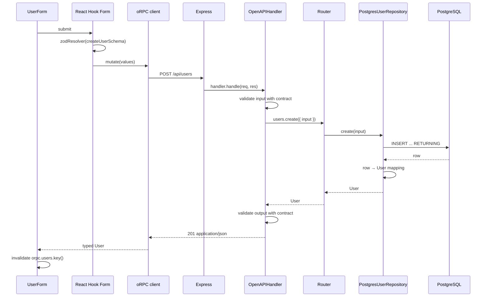

# Architecture and boundaries

## Dependency direction

```text
packages/contracts
  ├─ Zod API schemas
  ├─ oRPC contract
  └─ ApiClient type
        ▲                         ▲
        │                         │
   apps/api                  apps/web
   ├─ router                 └─ OpenAPILink
   ├─ UserRepository              │
   └─ Postgres adapter            └─ TanStack Query / React Hook Form
        │
        ▼
   PostgreSQL 19
```

Rules:

- `contracts` depends only on `zod` and `@orpc/contract`. It knows nothing about Express, Kysely, or
  React.
- `api` depends on `contracts` and implements the transport, repository boundary, and persistence.
- `web` depends on `contracts` and creates a client from it.
- Server implementation details never enter the web bundle.

The contract package is built with `tsc` to `dist` and consumed through the workspace symlink. During
development, the root `pnpm dev` command watches it, so contract edits propagate to the API and web.

## Two sources of truth, deliberately

There are two different kinds of truth:

1. **API truth** — what HTTP accepts and returns. Zod and oRPC own this.
2. **Persistence truth** — durable columns, constraints, indexes, and foreign keys. PostgreSQL
   migrations own this.

Kysely types are generated from the migrated database into `schema.generated.ts`. The repository
mapper converts a generated row into a Zod-owned API type. TypeScript checks both sides, so drift is
a compile error.

The mapper is not duplicate validation. It is the boundary between persistence and the public API.
See [database.md](database.md) for the full rationale.

## Request lifecycle



## Error policy

- **400** — input validation failed. Client error; not logged as a server incident.
- **409** — duplicate email, mapped from PostgreSQL unique violation to a domain error and then to
  `ORPCError('CONFLICT')`.
- **404** — no oRPC procedure and no Express route matched.
- **500** — unexpected server or database error. The `onError` interceptor logs it.

The OpenAPI handler validates both input and output. If an implementation returns a value that does
not match the output schema, the contract fails rather than silently leaking inconsistent data.

## SOLID boundaries

### Single Responsibility

- `packages/contracts/src/schemas/*` — API validation and inferred types.
- `packages/contracts/src/contract.ts` — route metadata and schema attachment.
- `apps/api/src/router/index.ts` — maps procedures to dependencies and domain errors.
- `apps/api/src/modules/users/user.repository.ts` — the persistence port.
- `apps/api/src/modules/users/postgres-user.repository.ts` — the Postgres adapter and row mapper.
- `apps/api/src/db/*` — connection, migrations, generated types, startup/shutdown.
- `apps/api/src/app.ts` — HTTP concerns: Express, CORS, Helmet, handler mounting.
- `apps/web/src/lib/orpc.ts` — transport and query utilities.
- `apps/web/src/routes/*` — routing and page composition.
- `apps/web/src/components/UserForm.tsx` — the form interaction.

### Open/Closed

Adding a feature means adding a schema, contract entry, migration, repository capability, handler,
and route. Existing schemas, client types, validators, and migrations are not edited.

### Liskov Substitution

`PostgresUserRepository` implements `UserRepository`. A test adapter or another database adapter
must honor the same async `list()` and `create()` contract. The router depends only on the interface.

### Interface Segregation

`UserRepository` exposes only `list` and `create`. A larger system can split read and write ports if
consumers need different capabilities.

### Dependency Inversion

- The router depends on `UserRepository`, not on Kysely or `pg`.
- `index.ts` is the composition root: it creates the Kysely client and injects
  `PostgresUserRepository`.
- The web depends on `ApiClient` and the contract, not on server modules.
- Handlers are ordinary typed functions, so they can be called in tests or server-side jobs without
  HTTP.

## Composition roots

- **API**: `apps/api/src/index.ts` creates the Kysely client, verifies the connection, injects
  `PostgresUserRepository`, and destroys the pool during graceful shutdown.
- **Database**: `apps/api/src/db/client.ts` owns the `pg.Pool` and Kysely dialect.
- **Web**: `apps/web/src/main.tsx` creates the `QueryClient`, wraps `RouterProvider`, and imports the
  singleton router from `apps/web/src/router.ts`.

Keeping construction at the edges is what makes the middle replaceable.

## Migration boundaries

- Migration files are frozen historical artifacts. They use `Kysely<any>` and do not import the
  current app schema.
- `db:migrate` is a deploy step, never part of API startup.
- `db:rollback` is guarded in production.
- Migration tests default to in-memory PGlite and can run against real PostgreSQL 19 via
  `TEST_DATABASE_URL`.
- Kysely migrations use session-level advisory locks; do not run them through PgBouncer transaction
  pooling.

## Safety checklist

- Contract validation is the server-side boundary; form validation is only UX.
- oRPC is mounted before `express.json()` because it consumes raw request bodies.
- Environment variables are parsed with Zod at process start; `DATABASE_URL` is required.
- `.env` is ignored; `.env.example` is the committed template.
- CORS is restricted by `CORS_ORIGIN`.
- Helmet is enabled.
- Expected 4xx errors do not produce server-error logs.
- Duplicate emails return 409, not 500.
- SIGINT/SIGTERM close the HTTP server and destroy the DB pool.
- Test databases must end in `_test`; only a generated schema is dropped.
- The generated Kysely schema is committed and regenerated with `pnpm db:types`.
- Authentication, authorization, rate limiting, and CI are explicit follow-ups.

## Why oRPC instead of Axios

OpenAPI code generation with Axios is a valid architecture, but it adds a generated client, a
generation step, and a second representation of the contract. oRPC gives the same type safety by
making the contract the client factory:

- `OpenAPILink` provides the transport.
- `createTanstackQueryUtils` provides typed query and mutation options.
- `OpenAPIGenerator` emits a standard spec for non-TypeScript consumers.

If an external consumer requires an Axios SDK, generate it from `apps/api/openapi.json` with Hey API.
Do not maintain it by hand and do not add it to this web app unless a concrete need appears.
